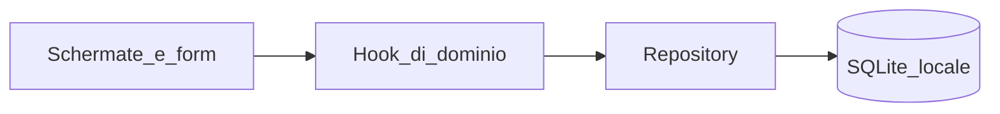

# MVP FoglioSpese — spese locali su Android

Il workspace oggi contiene solo la regola Cursor. Si parte da zero con **Expo + TypeScript**, persistenza **solo sul dispositivo**, UI in italiano.

## Stack

- **Expo** (SDK corrente) + **expo-router** (tab/stack)
- **SQLite** via `expo-sqlite` + **Drizzle ORM** (schema tipizzato, query per filtri; i grafici si agganciano dopo senza cambiare modello)
- Importi in **centesimi** (`INTEGER`) per evitare errori di virgola mobile; valuta fissa `EUR`
- Data/ora: un datetime ISO; in form due controlli distinti (data e ora)
- UI: React Native core + componenti chiari (liste, form, `Picker`/modal)
- Data: DatePicker Android in modalità **calendario** (`display="calendar"` / default, **niente spinner**) tramite `@react-native-community/datetimepicker`
- Ora: **campo di testo** `HH:mm` (24h) con validazione; azione **Adesso** che imposta l’ora corrente. Nessun TimePicker nativo

## Architettura

Struttura prevista:

- `[app/](app/)` — routing (`index` lista, `spese/nuova`, `spese/[id]`, `categorie`)
- `[src/db/](src/db/)` — schema Drizzle, migrazioni, seed
- `[src/data/](src/data/)` — repository spese/categorie (unico accesso al DB)
- `[src/domain/](src/domain/)` — tipi (`Expense`, `Category`, `Subcategory`)
- `[src/hooks/](src/hooks/)` — `useSpese`, `useCategorie`, filtri
- `[src/components/](src/components/)` — form, tendine, righe lista

Niente cloud, sync o auth. Un modulo dati isolato rende più facile aggiungerli dopo.

## Modello dati

- **categories**: `id`, `name`, `sortOrder`, `createdAt`
- **subcategories**: `id`, `categoryId` (FK), `name`, `sortOrder`
- **expenses**: `id`, `amountCents`, `currency` (`EUR`), `occurredAt` (ISO), `categoryId`, `subcategoryId`, `note` (opzionale), `createdAt`, `updatedAt`

Vincoli: sottocategoria deve appartenere alla categoria scelta; importo > 0.

**Seed iniziale** (modificabile dall’utente): Casa, Alimentari, Trasporti, Salute, Svago, Abbigliamento, Altro — ciascuna con 2–4 sottocategorie tipiche (es. Alimentari → Supermercato, Ristorante, Bar).

## Schermate MVP

1. **Lista spese** — elenco per data decrescente, importo in `it-IT` (es. `12,50 €`), categoria/sottocategoria. Filtri semplici: mese corrente / tutti, categoria, sottocategoria (la tendina sottocategorie si aggiorna in base alla categoria). Totale del filtro in testa. Nessun grafico.
2. **Nuova / modifica spesa** — importo EUR, **calendario data**, **ora testuale** (`HH:mm`) o pulsante **Adesso**, categoria, sottocategoria (filtrata), nota. Default: oggi; ora vuota finché l’utente non scrive o preme Adesso (in modifica si mostra l’ora salvata).
3. **Categorie** — elenco categorie; tap per sottocategorie; aggiungi/modifica/elimina. Eliminazione categoria: solo se non ha spese, oppure blocco con messaggio (niente cascata silenziosa).

Back Android: stack nativo expo-router.

## Form data/ora

Due campi separati, **niente spinner**.

- **Data**: campo che mostra `gg/mm/aaaa`; al tap apre il calendario Android (`display="calendar"`). Default: oggi.
- **Ora**: `TextInput` secco, placeholder `HH:mm` (24h). Accetta solo orari validi (`00:00`–`23:59`). Accanto, pulsante **Adesso** che scrive l’ora corrente del dispositivo. Se l’utente lascia vuoto e salva, si usa l’istante attuale (data scelta + ora di sistema), così non è obbligatorio digitare l’ora.

All’insert si uniscono in un unico `occurredAt`. Se l’ora è invalida, il form non salva e mostra un errore sotto il campo.

## Fuori dallo scope (fase 2+)

Budget, patrimonio, grafici, export, cloud, multi-valuta.

## Verifica

Avvio su emulatore/device Android (Expo), seed visibile, CRUD spesa, filtri, CRUD categorie, persistenza dopo chiusura app. Se i browser tools non coprono Expo Go, verifica con Metro + device e lo dichiaro.